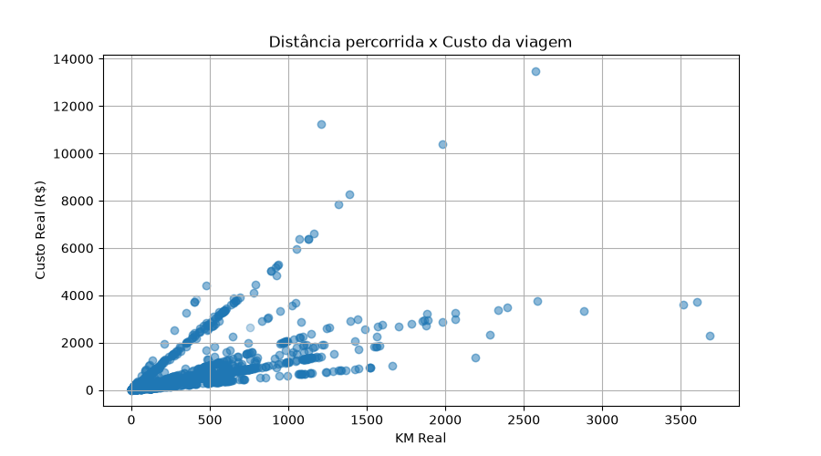
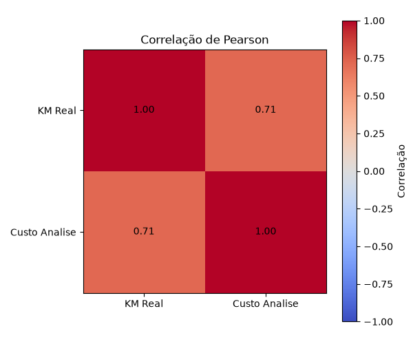
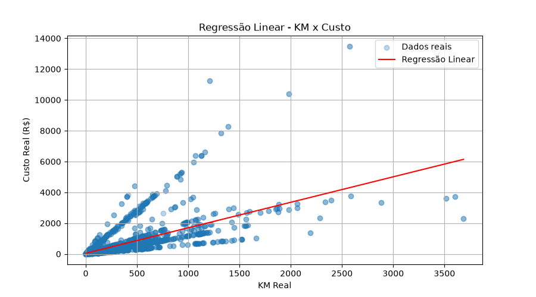
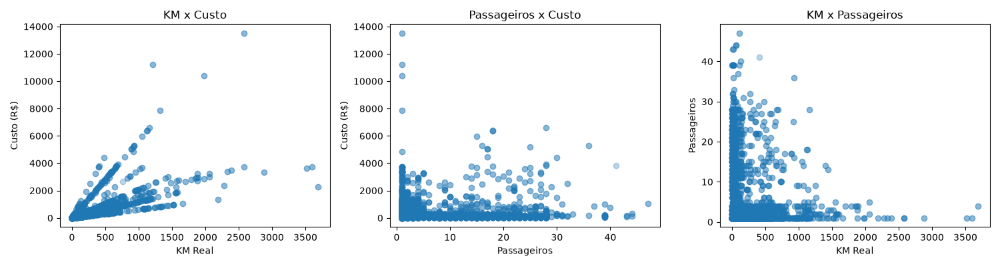
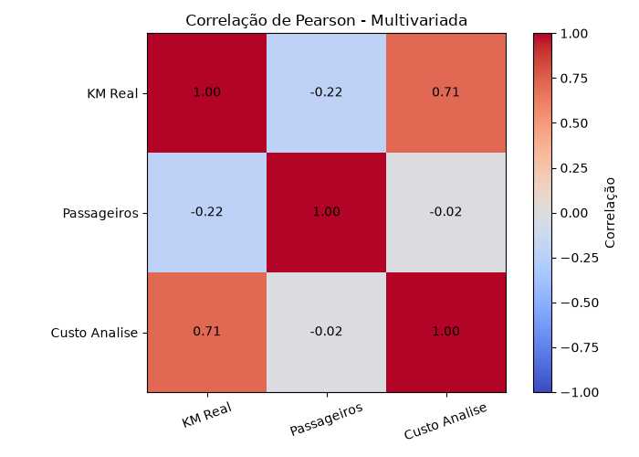
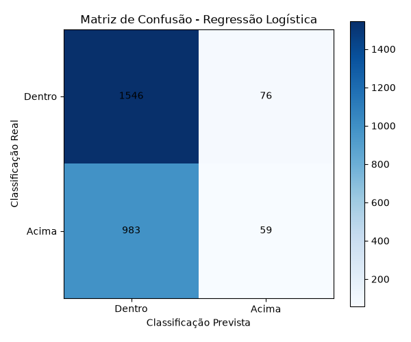

<div align="center">

# CITIZENTECH — ANÁLISE PREDITIVA DA FROTA

### Global Solution 2026.2 — FIAP

**Modelagem Linear para Aprendizado em Máquina**

Python • Estatística • Probabilidade • Regressão Linear • Machine Learning

</div>

---

## Equipe de desenvolvimento

Projeto desenvolvido por estudantes da FIAP para a disciplina de Modelagem Linear para Aprendizado em Máquina.

| Integrante | RM |
|---|---|
| Henrique de Souza Aragão | 570529 |
| Leonardo Scotti Tobias | 573305 |
| Natan Silva da Costa | 573100 |

**Professor:** Rodolfo Magliari de Paiva

---

## 1. Sobre o projeto

O **CitizenTech — Análise Estatística e Preditiva da Eficiência do Transporte Institucional** é um projeto acadêmico desenvolvido para a Global Solution 2026.2 da FIAP.

O projeto utiliza dados públicos reais sobre a utilização de uma frota para analisar a relação entre distância percorrida, quantidade de passageiros e custo das viagens.

A proposta consiste em aplicar técnicas estatísticas e modelos de aprendizado de máquina para identificar padrões, estimar custos e avaliar a possibilidade de uma viagem ultrapassar o orçamento previsto.

A solução está relacionada ao desafio CitizenTech, buscando demonstrar como a análise de dados pode contribuir para o planejamento e a utilização eficiente de recursos públicos.

### Fonte oficial dos dados

[Portal Brasileiro de Dados Abertos — Utilização da Frota](https://dados.gov.br/dados/conjuntos-dados/utilizacao-da-frota)

---

## 2. Objetivos

### Objetivo geral

Desenvolver análises estatísticas e modelos preditivos utilizando Python para estudar os custos e a utilização da frota, identificando padrões que possam auxiliar no planejamento das viagens.

### Objetivos específicos

- Realizar o tratamento e a exploração dos dados.
- Aplicar conceitos de distribuição normal.
- Calcular probabilidades e classificar eventos.
- Desenvolver testes de hipóteses para a média.
- Calcular covariância e correlação de Pearson.
- Construir modelos de regressão linear simples e múltipla.
- Avaliar os modelos utilizando R² e Teste F.
- Implementar regressão logística binária.
- Avaliar classificações por matriz de confusão e acurácia.
- Realizar previsões utilizando os modelos desenvolvidos.
- Interpretar os resultados e identificar oportunidades de melhoria.

---

## 3. Tecnologias utilizadas

| Tecnologia | Aplicação |
|---|---|
| Python | Linguagem principal |
| Pandas | Manipulação e tratamento dos dados |
| NumPy | Cálculos numéricos |
| Matplotlib | Geração de gráficos |
| Seaborn | Visualizações estatísticas |
| SciPy | Probabilidades e testes de hipóteses |
| Statsmodels | Regressão linear e logística |
| Scikit-learn | Divisão dos dados e métricas de classificação |
| Git | Controle de versões |
| GitHub | Armazenamento do projeto |

---

## 4. Base de dados

A base utilizada foi disponibilizada pelo Portal Brasileiro de Dados Abertos.

O arquivo original contém **13.351 registros e 29 colunas**.

### Variáveis utilizadas

| Variável | Descrição |
|---|---|
| KM Estimada | Distância planejada |
| KM Real | Distância percorrida |
| Custo Estimado | Custo previsto |
| Custo Real | Custo registrado |
| Passageiros | Quantidade de passageiros |
| Ano Veículo | Ano do veículo |
| Data Saída | Data de início da viagem |
| Data Retorno | Data de término da viagem |

### Tratamento dos dados

O tratamento foi realizado utilizando a biblioteca Pandas.

Foram executadas as seguintes operações:

- Identificação de valores ausentes.
- Verificação de registros duplicados.
- Remoção de colunas completamente vazias.
- Conversão das variáveis numéricas.
- Conversão das datas.
- Identificação de custos negativos.
- Criação de variáveis auxiliares.

Foi criada a coluna `Custo Analise`, na qual os valores negativos de custo real são considerados ausentes para as análises.

Os dados originais foram preservados, sem preenchimento artificial de informações.

**Observação:** embora o arquivo possua o nome `uso_da_frota_2025.csv`, foram identificadas datas de saída em 2026.

---

## 5. Distribuição Normal de Probabilidade

A variável escolhida foi `KM Real`, considerando 9.780 registros válidos.

### Medidas estatísticas

| Indicador | Resultado |
|---|---:|
| Quantidade de registros | 9.780 |
| Média | 149,86 km |
| Mediana | 26,00 km |
| Desvio padrão populacional | 284,13 km |

### Item A — Probabilidade menor que a média

Considerando uma distribuição normal:

P(X < média) = 50,00%

**Classificação:** evento possível.

### Item B — Probabilidade maior que a mediana

P(X > mediana) = 66,86%

**Classificação:** evento possível.

### Interpretação

A distribuição normal foi assumida conforme o enunciado da avaliação.

A diferença entre a média e a mediana sugere assimetria na distribuição observada das distâncias, indicando a presença de viagens com quilometragens elevadas.

---

## 6. Testes de Hipóteses

Foram realizados dois testes Z unilaterais para a média da variável `KM Real`.

A média populacional de referência utilizada foi de 149,86 km, com desvio padrão populacional de 284,13 km.

### 6.1. Teste A — Média menor

Hipóteses:

- H0: média maior ou igual à referência.
- H1: média menor que a referência.

| Indicador | Resultado |
|---|---:|
| Amostra | 20 |
| Média amostral | 148,50 km |
| Significância | 6% |
| Estatística Z | -0,0214 |
| Valor-p | 0,4915 |

**Decisão:** não rejeitar H0.

O valor-p é superior ao nível de significância. Portanto, não existem evidências estatísticas suficientes para afirmar que a média seja inferior à referência.

### 6.2. Teste B — Média maior

Hipóteses:

- H0: média menor ou igual à referência.
- H1: média maior que a referência.

| Indicador | Resultado |
|---|---:|
| Amostra | 25 |
| Média amostral | 175,44 km |
| Significância | 9% |
| Estatística Z | 0,4502 |
| Valor-p | 0,3263 |

**Decisão:** não rejeitar H0.

Mesmo com a média amostral superior à referência, o valor-p é maior que 0,09. Portanto, não há evidências suficientes para rejeitar a hipótese nula.

As amostras foram selecionadas de maneira reproduzível para representar os cenários solicitados no exercício. Essa seleção é uma demonstração didática e limita a interpretação inferencial dos testes.

---

## 7. Análise Bivariada

A análise bivariada utilizou duas variáveis quantitativas:

- **X:** KM Real.
- **Y:** Custo Analise.

Foram considerados **9.565 registros válidos**.

O objetivo foi verificar a relação entre a distância percorrida e o custo das viagens.

### 7.1. Gráfico de Dispersão



O gráfico apresenta uma tendência positiva entre a distância e o custo.

Em geral, viagens com maiores distâncias apresentam custos mais elevados. Entretanto, existe dispersão entre os registros e presença de valores extremos.

### 7.2. Covariância e Correlação de Pearson

| Medida | Resultado |
|---|---:|
| Covariância | 135.669,61 |
| Correlação de Pearson | 0,7131 |

A covariância positiva indica que as variáveis apresentam tendência de crescimento conjunto.

O coeficiente de Pearson de 0,7131 representa uma correlação linear positiva forte, segundo a escala de referência apresentada em aula.

### 7.3. Gráfico de Correlação de Pearson



O gráfico confirma a associação linear positiva entre as variáveis.

### 7.4. Regressão Linear Simples

A regressão linear simples foi desenvolvida utilizando `statsmodels.OLS()`, conforme a metodologia estudada durante as aulas.



### Equação da regressão

```text
Y = 46,49 + 1,6538 * X
```

Onde:

- Y representa o custo previsto.
- X representa a distância percorrida.

O coeficiente angular indica que cada quilômetro adicional está associado a um aumento médio estimado de aproximadamente R$ 1,65 no custo da viagem.

### 7.5. Verificação da adequação do modelo

| Indicador | Resultado |
|---|---:|
| R² | 0,5086 |
| R² percentual | 50,86% |
| Teste F | 9.896,3194 |
| Valor-p do Teste F | < 0,000001 |

O R² indica que aproximadamente 50,86% da variação observada nos custos é explicada pela distância no modelo linear simples.

O Teste F demonstrou significância estatística ao nível de 5%.

### 7.6. Previsão

Para uma viagem de 100 quilômetros:

**Custo previsto: R$ 211,87**

---

## 8. Análise Multivariada

A análise multivariada utilizou 8.699 registros válidos e três variáveis quantitativas:

- KM Real.
- Passageiros.
- Custo Analise.

O objetivo foi analisar as relações entre as três variáveis e desenvolver um modelo de regressão linear múltipla.

### 8.1. Gráficos de Dispersão



Os gráficos apresentam as relações entre quilômetros percorridos, passageiros e custo.

A relação positiva mais evidente ocorre entre distância e custo.

### 8.2. Matriz de Covariância

| Variável | KM Real | Passageiros | Custo Analise |
|---|---:|---:|---:|
| KM Real | 85.968,62 | -547,05 | 136.777,11 |
| Passageiros | -547,05 | 72,80 | -89,80 |
| Custo Analise | 136.777,11 | -89,80 | 426.053,97 |

A matriz apresenta as covariâncias entre as variáveis utilizadas.

### 8.3. Matriz de Correlação de Pearson



| Relação | Correlação |
|---|---:|
| KM Real x Custo | 0,7147 |
| Passageiros x Custo | -0,0161 |
| KM Real x Passageiros | -0,2187 |

A distância apresentou correlação positiva forte com o custo.

A quantidade de passageiros apresentou correlação individual praticamente nula com o custo.

### 8.4. Regressão Linear Múltipla

Foi utilizado o método dos mínimos quadrados ordinários com `statsmodels.OLS()`.

A equação obtida foi:

```text
Y = -49,75 + 1,6627 * KM + 11,2604 * Passageiros
```

Onde:

- Y representa o custo previsto.
- KM representa a distância percorrida.
- Passageiros representa a quantidade de passageiros.

Mantendo as demais variáveis constantes, cada quilômetro adicional está associado a aproximadamente R$ 1,66 a mais no custo estimado.

### 8.5. Avaliação do modelo

| Indicador | Resultado |
|---|---:|
| R² | 0,5314 |
| R² ajustado | 0,5313 |
| R² percentual | 53,14% |
| Teste F | 4.930,6299 |
| Valor-p | < 0,000001 |

O modelo explica aproximadamente 53,14% da variação observada nos custos.

O Teste F indicou significância estatística.

### 8.6. Previsão

Considerando uma viagem com:

- Distância: 100 km.
- Passageiros: 3.

**Custo previsto: R$ 150,30**

---

## 9. Regressão Logística Binária

A regressão logística foi utilizada para classificar as viagens de acordo com a relação entre o custo real e o custo estimado.

### Variável de classificação

| Classe | Significado |
|---|---|
| 0 | Custo real dentro do estimado |
| 1 | Custo real acima do estimado |

### Variáveis explicativas

- KM Estimada.
- Custo Estimado.
- Passageiros.

A análise considerou **8.880 registros válidos**, utilizando 70% para treinamento e 30% para teste.

A regressão foi desenvolvida utilizando `statsmodels.Logit()`, conforme a metodologia apresentada em aula.

### 9.1. Equação da Regressão Logística

A equação obtida foi:

```text
Z = -0,1936
  + 0,000200 * KM Estimada
  + 0,000110 * Custo Estimado
  - 0,045997 * Passageiros

P = 1 / (1 + e^(-Z))
```

A equação permite calcular a probabilidade de uma viagem ultrapassar o custo estimado.

### 9.2. Matriz de Confusão



| Real / Previsto | Dentro | Acima |
|---|---:|---:|
| Dentro | 1.546 | 76 |
| Acima | 983 | 59 |

### 9.3. Avaliação do modelo

| Indicador | Resultado |
|---|---:|
| Acurácia | 60,25% |
| Recall da classe 1 | 5,66% |
| Pseudo R² | 0,02826 |
| Acurácia de referência | 60,89% |

O modelo identificou corretamente 59 das 1.042 viagens que ultrapassaram o custo estimado.

Isso representa um recall de 5,66%, indicando baixa capacidade de identificação das viagens acima do orçamento.

A acurácia de 60,25% também ficou abaixo da referência de 60,89%, obtida ao considerar somente a classe mais frequente.

Portanto, o modelo apresenta limitações importantes para utilização prática.

### 9.4. Exemplo de classificação

Foram considerados os seguintes dados:

| Variável | Valor |
|---|---:|
| KM Estimada | 100 km |
| Custo Estimado | R$ 200,00 |
| Passageiros | 3 |

**Probabilidade de ultrapassar o custo estimado: 42,81%**

**Classificação: Dentro do custo estimado.**

---

## 10. Estrutura do projeto

```text
GS-MLPEM/
│
├── data/
│   ├── uso_da_frota_2025.csv
│   └── frota_tratada.csv
│
├── src/
│   ├── tratamento_dados.py
│   ├── distribuicao_normal.py
│   ├── testes_hipoteses.py
│   ├── analise_bivariada.py
│   ├── analise_multivariada.py
│   └── regressao_logistica.py
│
├── resultados/
│   └── graficos/
│       ├── dispersao.png
│       ├── correlacao_bivariada.png
│       ├── regressao_simples.png
│       ├── dispersao_multivariada.png
│       ├── correlacao_multivariada.png
│       └── matriz_confusao.png
│
├── relatorio/
│   └── relatorio_estatistico_GS.pdf
│
└── README.md
```

---

## 11. Como executar o projeto

### 11.1. Pré-requisitos

- Python instalado.
- Git instalado, caso deseje clonar o repositório.
- Bibliotecas utilizadas nas análises.

### 11.2. Clonar o repositório

```bash
git clone https://github.com/natan-costa01/GS-MLPEM.git
cd GS-MLPEM
```

### 11.3. Instalar as dependências

```powershell
py -m pip install pandas numpy matplotlib seaborn scipy statsmodels scikit-learn
```

### 11.4. Executar o tratamento de dados

```powershell
py src/tratamento_dados.py
```

### 11.5. Executar a distribuição normal

```powershell
py src/distribuicao_normal.py
```

### 11.6. Executar os testes de hipóteses

```powershell
py src/testes_hipoteses.py
```

### 11.7. Executar a análise bivariada

```powershell
py src/analise_bivariada.py
```

### 11.8. Executar a análise multivariada

```powershell
py src/analise_multivariada.py
```

### 11.9. Executar a regressão logística

```powershell
py src/regressao_logistica.py
```

Os gráficos são apresentados durante a execução e salvos em `resultados/graficos/`.

---

## 12. Limitações do projeto

O projeto apresenta algumas limitações relacionadas à qualidade dos dados e ao desempenho dos modelos.

Entre elas:

- Presença de valores ausentes.
- Existência de custos negativos nos registros originais.
- Valores extremos nas distâncias e nos custos.
- Grande diferença entre a média e a mediana das distâncias.
- Indícios de não normalidade dos resíduos nos modelos lineares.
- Poder explicativo moderado das regressões lineares.
- Baixa capacidade de identificação da classe positiva na regressão logística.
- Seleção didática das amostras nos testes de hipóteses.

Os modelos representam associações estatísticas, mas não demonstram relações de causa e efeito.

As previsões são destinadas à demonstração acadêmica e não devem ser utilizadas isoladamente para decisões financeiras ou operacionais.

---

## 13. Considerações finais

A Global Solution demonstrou a aplicação de conceitos de probabilidade, estatística e aprendizado de máquina utilizando dados reais de uma frota pública.

A análise bivariada identificou correlação positiva de 0,7131 entre distância e custo das viagens.

A regressão linear múltipla apresentou R² de 53,14%, demonstrando capacidade moderada para explicar a variação dos custos.

A regressão logística apresentou acurácia de 60,25%, porém demonstrou dificuldade em identificar viagens que ultrapassaram o orçamento, com recall de 5,66%.

Os resultados evidenciam a importância de interpretar os modelos estatísticos de maneira crítica, considerando tanto seus acertos quanto suas limitações.

O projeto contribuiu para a aplicação prática dos conceitos estudados durante o semestre, relacionando análise de dados, modelagem estatística e aprendizado de máquina ao contexto de eficiência dos serviços públicos.

---

## 14. Relatório Estatístico

O relatório estatístico apresenta as análises, os gráficos, as medidas estatísticas e suas respectivas interpretações.

**[Consultar Relatório Estatístico em PDF](relatorio/relatorio_estatistico_GS.pdf)**

---

<div align="center">

**CITIZENTECH — ANÁLISE PREDITIVA DA FROTA**

Global Solution 2026.2

Modelagem Linear para Aprendizado em Máquina

**FIAP**

[Repositório do projeto](https://github.com/natan-costa01/GS-MLPEM)

</div>
